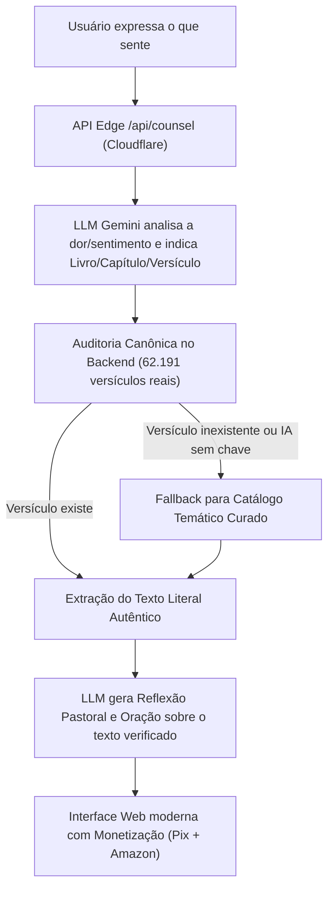

# 🕊️ Palavra Viva — Consolo & Direção na Bíblia Sagrada

> **Site moderno desenvolvido em Next.js 14, React e Tailwind CSS, otimizado para deploy gratuito no Cloudflare Pages, com Inteligência Artificial, motor anti-alucinação bíblica e canais de monetização integrados.**

---

## 🌟 Sobre o Site

O **Palavra Viva** é um site leve, sereno e responsivo (mobile-first) onde o usuário pode abrir o seu coração, descrever como se sente (ou tocar em sentimentos rápidos) e receber:

- 📖 **Passagem Bíblica Verificada:** Texto sagrado literal extraído da base canônica (versões **NVI** ou **Almeida Atualizada**).
- 🕊️ **Reflexão Pastoral & Acolhedora:** Uma mensagem carinhosa gerada para tocar a situação específica, sem julgamentos.
- 📜 **Contexto Bíblico Original:** 1 a 2 frases para compreender o sentido fiel do texto histórico.
- 🙏 **Oração Pessoal Conduzida:** Uma prece sincera e íntima em primeira pessoa para o usuário orar.
- 💡 **Passo Prático de Fé:** Uma atitude simples e reconfortante para o dia.
- 🔊 **Áudio Narrado:** Voz natural em português via Web Speech API (zero latência e sem custo de servidores de voz).
- 📱 **Compartilhar no WhatsApp:** Botão com mensagem pronta e formatada para enviar a amigos ou postar no Status.
- 📖 **Leitor do Capítulo Completo:** Modal dinâmico para ler todo o capítulo com destaque dourado nos versículos selecionados.

---

## 💰 Como Funciona a Monetização do Site

O site já vem com **3 canais de monetização prontos** para você lucrar de forma respeitosa e ética:

### 1. Doações Voluntárias via Pix ("Apoie esta Obra")
- No cabeçalho e logo após o devocional há um botão discreto e caloroso de apoio.
- Abre um modal com botão **"Copiar Chave Pix"** com 1 clique.
- **Como configurar sua chave:** Configure a variável de ambiente no Cloudflare:
  - `NEXT_PUBLIC_PIX_KEY`: Sua chave Pix (ex: seu e-mail, telefone ou chave aleatória).
  - `NEXT_PUBLIC_PIX_NAME`: Seu nome ou nome do projeto.

### 2. Programa de Associados Amazon (Comissões de até 15% em Livros e Bíblias)
- Abaixo de cada reflexão, o site recomenda de forma contextual livros cristãos consagrados e Bíblias de Estudo (ex: se o usuário está ansioso, recomenda livros de cura da ansiedade e Bíblias de Estudo; se está em luto, recomenda livros de consolo).
- Cada botão leva para a Amazon com a sua tag de afiliado.
- **Como configurar sua tag:**
  - `NEXT_PUBLIC_AMAZON_TAG`: Sua tag de associado Amazon (ex: `seunome-20`). Cadastre-se gratuitamente em [associados.amazon.com.br](https://associados.amazon.com.br).

### 3. Google AdSense / Banners de Anúncios
- O site possui posições responsivas preparadas para banners de anúncios (entre o versículo e a oração e no rodapé).
- Ficam 100% ocultos até você configurar seu AdSense, garantindo visual perfeito sem caixas vazias.
- **Como configurar:**
  - `NEXT_PUBLIC_ADSENSE_CLIENT`: Seu ID de publicador (ex: `ca-pub-XXXXXXXXXXXXX`).
  - `NEXT_PUBLIC_ADSENSE_SLOT_TOP` / `NEXT_PUBLIC_ADSENSE_SLOT_BOTTOM`: Códigos dos seus blocos de anúncios.

---

## 🛡️ Arquitetura Anti-Alucinação (Zero Fake Verses)

Ao contrário de sites que deixam IAs gerativas "recitarem" versículos de memória (o que quase sempre gera versículos inventados ou números trocados), o **Palavra Viva** utiliza um **pipeline de auditoria canônica estrita**:



1. **A IA NÃO inventa texto bíblico:** Ela apenas atua como conselheira e sugere o livro/capítulo canônico.
2. **Auditoria Canônica em Tempo Real:** O backend busca o texto literal na base canônica dos 66 livros da Bíblia protestante.
3. **Resguardo 100%:** Se a IA indicar qualquer referência incorreta, o validador substitui pelo tema canônico mais próximo. **Nenhum versículo falso é exibido.**

---

## 🌐 Como Colocar no Ar no Cloudflare Pages (Passo a Passo)

1. Acesse o **[Painel da Cloudflare](https://dash.cloudflare.com/)**.
2. No menu lateral esquerdo, vá em **Compute (Workers & Pages)** ➔ **Create application** ➔ selecione a aba **Pages**.
3. Clique em **Connect to Git** e selecione o seu repositório: `palavra-viva`.
4. Na tela de configuração de build:
   - **Framework preset:** Selecione `Next.js`.
   - **Build command:** `npm run build`
   - **Build output directory:** `.next`
5. Na seção **Environment variables (advanced)**, adicione:
   - `GEMINI_API_KEY`: Sua chave gratuita do Google AI Studio.
   - `NEXT_PUBLIC_PIX_KEY`: Sua chave Pix para receber doações.
   - `NEXT_PUBLIC_PIX_NAME`: Seu nome ou nome do projeto.
   - `NEXT_PUBLIC_AMAZON_TAG`: Sua tag de associado Amazon (ex: `seunome-20`).
6. Clique no botão azul **Save and Deploy**. Em cerca de 1 a 2 minutos o site estará online no CDN global da Cloudflare com SSL gratuito!

---

## 💻 Como Rodar Localmente no seu Computador

```bash
cd "c:\Users\User\Documents\Cassio\palavra-viva"
npm run dev
```

Abra o seu navegador e acesse: **`http://localhost:3000`**.

---

## 🔑 Como Obter a Chave Gratuita do Gemini

1. Acesse o **[Google AI Studio](https://aistudio.google.com/)**.
2. Faça login com qualquer conta Google.
3. Clique em **"Get API key"** ➔ **"Create API key"**.
4. Configure no Cloudflare como `GEMINI_API_KEY`.
