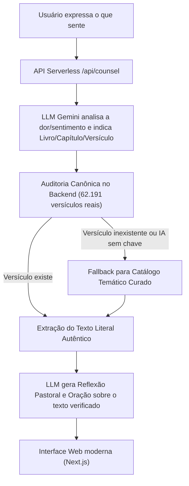

# 🕊️ Palavra Viva — Consolo & Direção na Bíblia Sagrada

> **Site moderno desenvolvido em Next.js 14, React e Tailwind CSS, otimizado para deploy gratuito na Vercel ou Cloudflare, com Inteligência Artificial e 100% livre de alucinações bíblicas.**

---

## 🌟 Sobre o Site

O **Palavra Viva** é um site leve, sereno e responsivo (mobile-first) onde o usuário pode abrir o seu coração, descrever como se sente (ou tocar em sentimentos rápidos) e receber:

- 📖 **Passagem Bíblica Verificada:** Texto sagrado literal extraído da base canônica (versões **NVI** ou **Almeida Atualizada**).
- 🕊️ **Reflexão Pastoral & Acolhedora:** Uma mensagem carinhosa gerada para tocar a situação específica, sem julgamentos.
- 📜 **Contexto Bíblico Original:** 1 a 2 frases para compreender o sentido fiel do texto histórico.
- 🙏 **Oração Pessoal Conduzida:** Uma prece sincera e íntima em primeira pessoa para o usuário orar.
- 💡 **Passo Prático de Fé:** Uma atitude simples e reconfortante para o dia.
- 🔊 **Áudio Narrado:** Voz natural em português via Web Speech API (zero latência e sem custo de servidores).
- 📱 **Compartilhar no WhatsApp:** Botão com mensagem pronta e formatada para enviar a amigos ou postar no Status.
- 📖 **Leitor do Capítulo Completo:** Modal dinâmico para mergulhar em todo o contexto bíblico com destaque dourado nos versículos selecionados.

---

## 🛡️ Arquitetura Anti-Alucinação (Zero Fake Verses)

Ao contrário de sites que deixam IAs gerativas "recitarem" versículos de memória (o que quase sempre gera versículos inventados ou números trocados), o **Palavra Viva** utiliza um **pipeline de auditoria canônica estrita**:



1. **A IA NÃO inventa texto bíblico:** Ela apenas atua como conselheira e sugere o livro/capítulo canônico.
2. **Auditoria Canônica em Tempo Real:** O backend serverless busca o texto literal na base canônica dos 66 livros da Bíblia protestante.
3. **Resguardo 100%:** Se a IA indicar qualquer referência incorreta, o validador substitui pelo tema canônico mais próximo. **Nenhum versículo falso é exibido.**
4. **Funciona até sem chave de IA:** Mesmo sem chave do Gemini configurada, o site funciona perfeitamente utilizando o motor local de correspondência bíblica.

---

## 🚀 Como Colocar no Ar Grátis na Vercel (Em 2 Minutos)

O projeto foi configurado com suporte nativo para a **Vercel**:

### 1. Enviar o Código para o seu GitHub
Abra o terminal na pasta do projeto e envie para o seu repositório:
```bash
git remote add origin https://github.com/SEU_USUARIO/palavra-viva.git
git push -u origin main
```

### 2. Importar na Vercel (Gratuito)
1. Acesse **[vercel.com](https://vercel.com/)** e faça login com sua conta do GitHub.
2. Clique em **"Add New..."** ➔ **"Project"**.
3. Selecione o repositório `palavra-viva`.
4. (Opcional) Em **Environment Variables**, adicione sua chave gratuita do Gemini:
   - `GEMINI_API_KEY`: `sua_chave_aqui`
5. Clique em **"Deploy"**.
6. Pronto! Em menos de 1 minuto seu site estará no ar com HTTPS gratuito em `https://palavra-viva.vercel.app`.

---

## 🌐 Como Subir no Cloudflare Pages

O projeto também pode ser publicado no **Cloudflare Pages**:
1. No painel do Cloudflare, vá em **Workers & Pages** ➔ **Create application** ➔ **Pages**.
2. Conecte sua conta do GitHub e selecione o repositório `palavra-viva`.
3. Defina o Build preset como **Next.js**.
4. Configure a variável de ambiente `GEMINI_API_KEY` (se desejar).
5. Clique em **Save and Deploy**.

---

## 💻 Como Rodar Localmente no seu Computador

Requisitos: Node.js 18+ instalado.

```bash
# 1. Acesse a pasta do projeto
cd palavra-viva

# 2. Instale as dependências (já instaladas localmente)
npm install

# 3. Inicie o servidor de desenvolvimento
npm run dev
```

Abra o seu navegador e acesse: **`http://localhost:3000`**.

---

## 🔑 Como Obter a Chave Gratuita do Gemini (Opcional)

1. Acesse o **[Google AI Studio](https://aistudio.google.com/)**.
2. Faça login com qualquer conta Google.
3. Clique em **"Get API key"** ➔ **"Create API key"**.
4. Você pode configurar essa chave como variável de ambiente no servidor (`GEMINI_API_KEY`) ou informá-la diretamente pelo botão de **Configurações** na interface do site (fica salva no seu navegador).

---

## 📁 Estrutura de Pastas do Site

```
palavra-viva/
├── src/
│   ├── app/
│   │   ├── api/
│   │   │   ├── counsel/route.ts  # Endpoint serverless de aconselhamento com auditoria
│   │   │   ├── chapter/route.ts  # Endpoint para leitura do capítulo completo
│   │   │   └── themes/route.ts   # Endpoint de catálogo temático
│   │   ├── globals.css           # Estilos globais e Tailwind CSS
│   │   ├── layout.tsx            # Estrutura HTML, fontes serifadas e metadados SEO
│   │   └── page.tsx              # Página inicial interativa
│   ├── components/
│   │   ├── Header.tsx            # Cabeçalho com logo, status e configurações
│   │   ├── SentimentChips.tsx    # Pílulas rápidas de estado emocional
│   │   ├── VerseCard.tsx         # Cartão sagrado, áudio, WhatsApp e cópia
│   │   ├── DevotionalTabs.tsx    # Abas devocionais (Pastoral, Oração, Contexto, Ação)
│   │   ├── ChapterModal.tsx      # Modal de leitura do capítulo bíblico completo
│   │   ├── SettingsModal.tsx     # Modal de preferência de versão (NVI/AA) e chave IA
│   │   └── Footer.tsx            # Rodapé sereno
│   └── lib/
│       └── bible.ts              # Motor canônico anti-alucinação e indexador bíblico
├── data/
│   ├── pt_nvi.json               # Bíblia NVI completa (66 livros canônicos)
│   ├── pt_aa.json                # Bíblia Almeida Atualizada completa
│   └── thematic_catalog.json     # Catálogo temático curado com orações
├── package.json                  # Dependências e scripts Next.js
├── tailwind.config.ts            # Cores sagradas douradas e tipografia
├── tsconfig.json                 # Configuração TypeScript
└── vercel.json                   # Configuração de deploy Vercel
```
