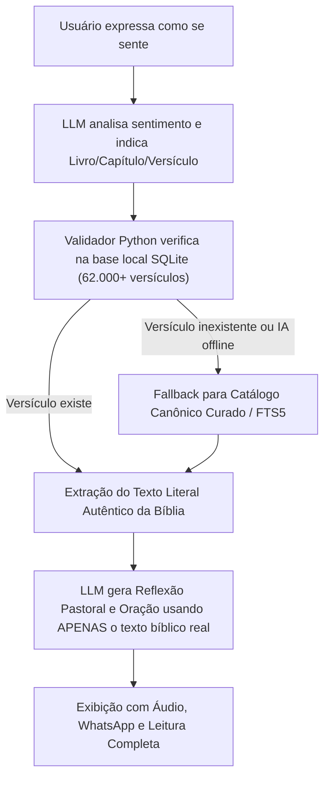

# 🕊️ Palavra Viva — Consolo & Direção na Bíblia Sagrada

> **Um refúgio espiritual digital que acolhe o que você sente e responde com uma passagem bíblica real, 100% verificada, livre de alucinações.**

---

## 🌟 Sobre o Projeto

O **Palavra Viva** é uma aplicação web moderna, serena e acolhedora desenvolvida para conectar o coração humano à Palavra de Deus. 

O usuário expressa livremente como se sente (ansiedade, tristeza, luto, cansaço, gratidão, necessidade de perdão, busca por direção) ou seleciona sentimentos pré-definidos, e a aplicação retorna:
- 📖 **Passagem Bíblica Verificada** (na versão NVI ou Almeida Atualizada).
- 🕊️ **Reflexão Pastoral Acolhedora** (sem julgamentos, com amor cristão e esperança).
- 📜 **Contexto Bíblico Original** (para compreensão fidedigna sem descontextualização).
- 🙏 **Oração Pessoal Conduzida** (para a pessoa falar com Deus naquele momento).
- 💡 **Passo Prático de Fé** (um exercício simples e tranquilizador para o dia de hoje).
- 🔊 **Áudio da Passagem** (ouça o versículo narrado com voz serena).
- 📱 **Compartilhar no WhatsApp** (link formatado com emojis pronto para envio ou status).
- 📖 **Ler o Capítulo Completo** (leitor integrado para mergulhar no contexto de toda a passagem).

---

## 🛡️ Arquitetura Anti-Alucinação (Zero Fake Verses)

Muitas IAs generativas têm o vício de "alucinar" versículos (inventando frases com som bíblico ou citando capítulos inexistentes). O **Palavra Viva** resolve isso com uma arquitetura de duas etapas com **Grounding Estrito**:



1. **Etapa 1 (Intenção Espiritual):** A IA identifica o núcleo emocional e seleciona a melhor referência canônica (ex: *Filipenses 4:6-7*).
2. **Etapa 2 (Auditoria Canônica):** O backend consulta a base de dados SQLite local com todos os 66 livros bíblicos canônicos.
3. **Etapa 3 (Garantia de Autenticidade):** Apenas o texto literal autêntico da Bíblia é enviado para a tela e para a reflexão devocional. Se a IA sugerir qualquer referência inválida, o sistema auto-corrige e recorre ao acervo canônico curado.
4. **Modo Offline / Sem Chave:** Mesmo sem nenhuma chave de API configurada, o app funciona 100% usando o motor de busca semântico local e acervo temático.

---

## 🚀 Como Colocar no Ar em Servidor Gratuito (Streamlit Cloud)

Você pode publicar o **Palavra Viva** na internet em menos de 2 minutos sem gastar nada:

### 1. Criar o Repositório no GitHub
1. Crie um novo repositório no seu GitHub (ex: `palavra-viva`).
2. Faça o push dos arquivos desta pasta para o repositório:
   ```bash
   git init
   git add .
   git commit -m "Initial commit - Palavra Viva"
   git branch -M main
   git remote add origin https://github.com/SEU_USUARIO/palavra-viva.git
   git push -u origin main
   ```

### 2. Conectar ao Streamlit Community Cloud (Gratuito)
1. Acesse **[share.streamlit.io](https://share.streamlit.io/)** e faça login com sua conta do GitHub.
2. Clique no botão **"New app"**.
3. Selecione o repositório `palavra-viva`, branch `main` e arquivo principal `app.py`.
4. Em **Advanced settings** (opcional), adicione o segredo da sua API do Gemini:
   ```toml
   GEMINI_API_KEY = "sua_chave_aqui"
   ```
5. Clique em **"Deploy!"**. Em cerca de 1 minuto, seu site estará no ar com HTTPS gratuito!

---

## 🔑 Como Obter a Chave Gratuita do Google Gemini

1. Acesse o **[Google AI Studio](https://aistudio.google.com/)**.
2. Faça login com qualquer conta Google.
3. Clique em **"Get API key"** e em seguida em **"Create API key"**.
4. Copie a chave gerada e cole no campo da barra lateral do app ou salve nos Secrets do Streamlit Cloud.
> *O plano gratuito do Google AI Studio oferece até 15 requisições por minuto sem custo.*

---

## 💻 Como Rodar Localmente

Certifique-se de ter o Python 3.10+ instalado:

```bash
# Clone o repositório
git clone https://github.com/SEU_USUARIO/palavra-viva.git
cd palavra-viva

# Instale as dependências
pip install -r requirements.txt

# Execute a aplicação
streamlit run app.py
```

O site abrirá automaticamente no seu navegador em `http://localhost:8501`.

---

## 📁 Estrutura de Arquivos

```
palavra-viva/
├── app.py                      # Aplicação web principal em Streamlit
├── requirements.txt            # Dependências do projeto (streamlit, gTTS, google-generativeai)
├── README.md                   # Documentação completa
├── .gitignore                  # Arquivos ignorados pelo controle de versão
├── .streamlit/
│   └── config.toml             # Tema sereno personalizado (cores e tipografia)
├── .github/
│   └── workflows/
│       └── keep_alive.yml      # Ação opcional para manter o app sempre acordado
├── data/
│   ├── pt_nvi.json             # Bíblia Nova Versão Internacional completa
│   ├── pt_aa.json              # Bíblia Almeida Atualizada completa
│   └── thematic_catalog.json   # Acervo canônico curado de temas de aconselhamento
└── services/
    ├── bible_db.py             # Gerenciador da base SQLite com busca FTS5 e verificação
    ├── thematic_engine.py      # Motor de busca por pontuação de sentimento
    ├── llm_service.py          # Integração Gemini com Grounding Anti-Alucinação
    └── audio_service.py        # Narração de áudio da passagem
```

---

## 🕊️ Licença e Direitos

- Textos bíblicos em domínio público / uso justo devocional.
- Código sob licença MIT — sinta-se livre para usar, compartilhar e abençoar vidas.
